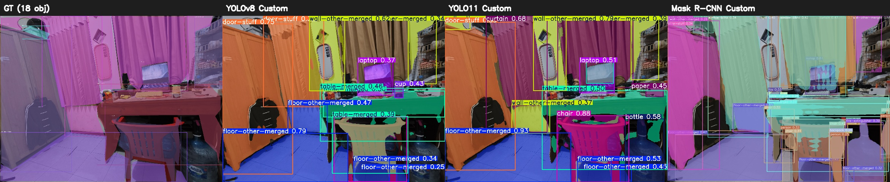
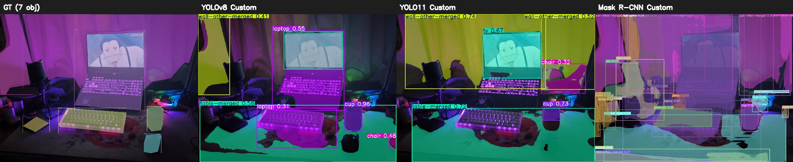
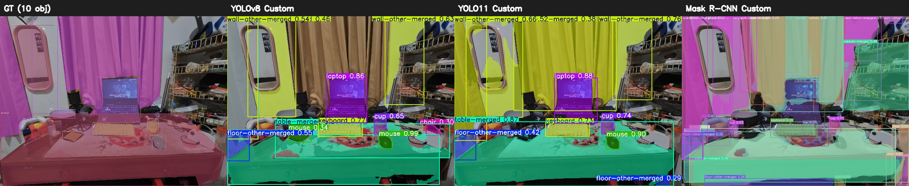
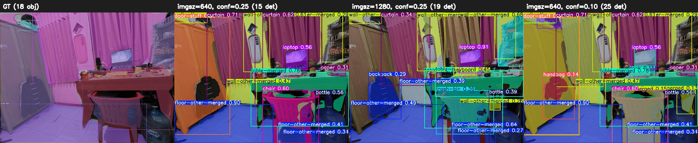
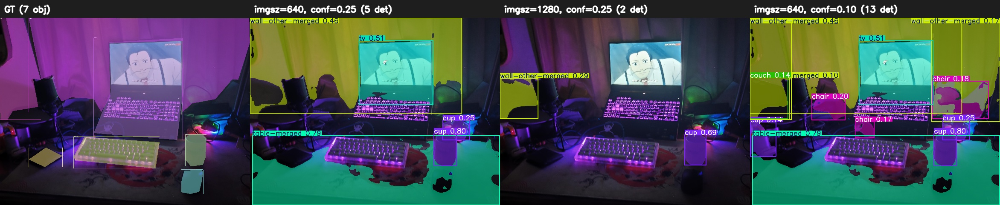
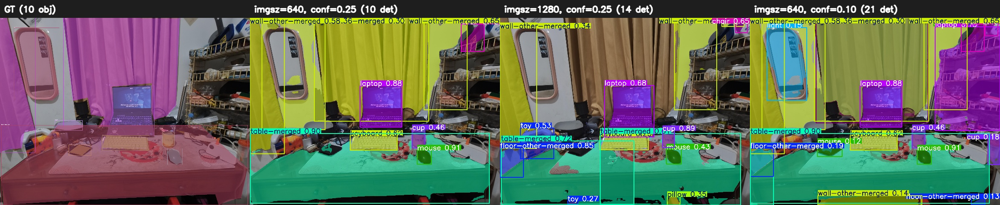
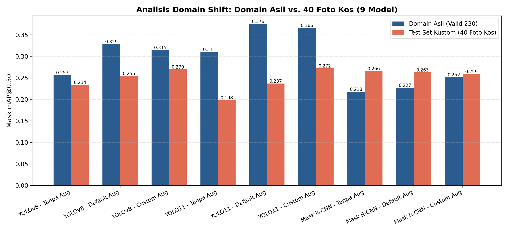
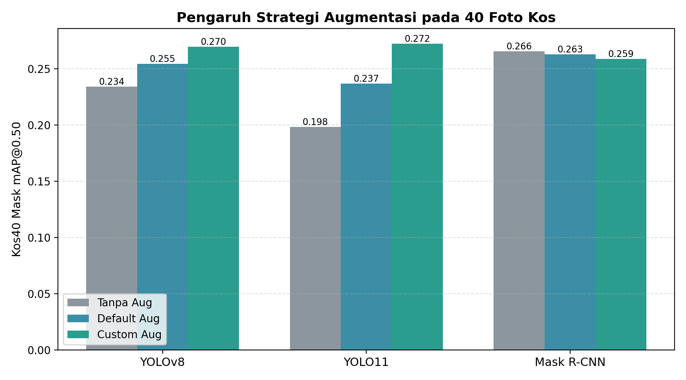

# Evaluasi Segmentasi Instance pada Dataset Indoor

Repositori ini berisi notebook dan hasil evaluasi untuk tugas **Segmentasi Instance (CPMK 3)**. Eksperimen membandingkan tiga model, yaitu YOLOv8, YOLO11, dan Mask R-CNN, dengan tiga pengaturan augmentasi. Hasilnya diuji pada split `valid` dari dataset dan pada 40 foto kos.

- **Notebook:** [tugas-viskom-instance.ipynb](tugas-viskom-instance.ipynb)
- **Hasil evaluasi:** [results](results/)

## 1. Profil Tugas & Eksperimen

| Komponen | Keterangan |
|---|---|
| Model | YOLOv8, YOLO11, dan Mask R-CNN |
| Pengaturan augmentasi | Tanpa augmentasi, default, dan kustom|
| Jumlah konfigurasi | `9` kombinasi model dan augmentasi |
| Data evaluasi | `230` gambar pada split `valid` dan `40` foto kos pada split `test` |
| Jumlah kelas dataset | `74` kelas |
| Kelas pada rekap foto kos | `30` kelas |
| Ukuran input YOLO | `640` piksel |
| Ukuran input Mask R-CNN | Sisi terpanjang dibatasi hingga `1280` piksel |
| Ambang confidence | `0.25` |

Dataset Roboflow memiliki 74 kelas. Rekap AP pada 40 foto kos mencatat 30 kelas. Jadi, angka 30 merujuk pada kelas di rekap evaluasi foto kos, bukan jumlah kelas seluruh dataset.

Foto kos yang dievaluasi memiliki resolusi antara `2448 × 3264` dan `4080 × 3060` piksel. Dataset ini digunakan untuk melihat performa model pada foto ruangan yang berbeda dari data validasi.

## 2. Hasil Training

Log training dan konfigurasi tiap run ada di [results/training](results/training/). File `results.csv` menyimpan metrik per epoch. Log YOLO juga mencatat durasi run pada kolom `time`.

| Model | Augmentasi | Epoch selesai | Durasi yang tercatat |
|---|---|---:|---:|
| YOLOv8 | Tanpa augmentasi | 37 | 0.114 jam |
| YOLOv8 | Default | 35 | 0.157 jam |
| YOLOv8 | Kustom | 59 | 0.310 jam |
| YOLO11 | Tanpa augmentasi | 30 | 0.096 jam |
| YOLO11 | Default | 70 | 0.327 jam |
| YOLO11 | Kustom | 100 | 0.524 jam |
| Mask R-CNN | Tanpa augmentasi | 15 | - |
| Mask R-CNN | Default | 15 | - |
| Mask R-CNN | Kustom | 15 | - |

Total durasi yang tercatat untuk enam run YOLO sekitar `1.53 jam`. Durasi ini diambil dari log training, tetapi jenis GPU tidak tercatat di file konfigurasi. Jadi, angka tersebut adalah durasi run dan bukan catatan GPU-jam yang terverifikasi. Log Mask R-CNN hanya mencatat train loss dan validation loss.

Dataset dan bobot model tidak disertakan di repository. Tiga checkpoint Mask R-CNN masing-masing berukuran sekitar `185 MB`, sehingga terlalu besar untuk ditaruh langsung di GitHub.

## 3. Hasil Evaluasi

Metrik utama yang digunakan adalah *mask mAP@0.50*. Tabel berikut juga memuat mAP@0.50-0.95, perubahan skor dari data validasi ke foto kos, dan latensi rata-rata.

| Model | mAP@0.50 valid | mAP@0.50 foto kos | mAP@0.50-0.95 foto kos | Perubahan mAP@0.50 (%) | Latensi (ms/gambar) |
|---|---:|---:|---:|---:|---:|
| YOLOv8 (tanpa augmentasi) | 0.2567 | 0.2342 | 0.1517 | 8.7 | 239.80 |
| YOLOv8 (default) | 0.3286 | 0.2545 | 0.1727 | 22.5 | 203.75 |
| YOLOv8 (kustom) | 0.3148 | 0.2697 | **0.1859** | 14.3 | **195.29** |
| YOLO11 (tanpa augmentasi) | 0.3106 | 0.1984 | 0.1205 | 36.1 | 196.34 |
| YOLO11 (default) | **0.3757** | 0.2368 | 0.1448 | 37.0 | 198.02 |
| YOLO11 (kustom) | 0.3662 | **0.2724** | 0.1721 | 25.6 | 195.53 |
| Mask R-CNN (tanpa augmentasi) | 0.2180 | 0.2657 | 0.1633 | -21.8 | 347.76 |
| Mask R-CNN (default) | 0.2269 | 0.2630 | 0.1548 | -15.9 | 362.68 |
| Mask R-CNN (kustom) | 0.2517 | 0.2589 | 0.1590 | -2.9 | 373.59 |

Perubahan skor dihitung dengan membandingkan hasil foto kos terhadap split `valid`. Nilai positif menunjukkan skor foto kos lebih rendah. Nilai negatif menunjukkan skor foto kos lebih tinggi.

### Temuan utama

1. **Skor mAP@0.50 tertinggi pada foto kos** diperoleh YOLO11 dengan augmentasi kustom, yaitu `0.2724`. YOLOv8 kustom mendapat skor `0.2697`.
2. **Skor mAP@0.50-0.95 tertinggi** diperoleh YOLOv8 kustom, yaitu `0.1859`. Konfigurasi ini juga mencatat latensi terendah, sekitar `195 ms` per gambar.
3. Pengaruh augmentasi berbeda pada setiap model. YOLO11 default mendapat skor valid tertinggi, yaitu `0.3757`, sedangkan YOLO11 kustom mendapat skor foto kos lebih tinggi daripada versi default.
4. Ketiga konfigurasi Mask R-CNN mendapat skor foto kos yang lebih tinggi daripada skor pada split `valid`. Hasil ini berlaku untuk kumpulan foto yang digunakan dalam eksperimen ini.
5. Tidak ada satu konfigurasi yang unggul pada semua metrik. YOLO11 kustom mendapat mAP@0.50 foto kos tertinggi. YOLOv8 kustom unggul pada mAP@0.50-0.95 dan latensi.

### Contoh Hasil pada Foto Test

Panel berikut membandingkan anotasi *ground truth* dengan hasil tiga model kustom pada foto test.

## 4. Pengaturan Augmentasi

- **Tanpa augmentasi:** augmentasi dinonaktifkan pada konfigurasi YOLO.
- **Default:** menggunakan augmentasi bawaan Ultralytics untuk YOLO.
- **Kustom:** YOLO menggunakan pengaturan warna `hsv_s=0.7` dan `hsv_v=0.6`, rotasi `degrees=30`, mosaic, dan mixup. Pada Mask R-CNN, augmentasi kustom mencakup perubahan warna serta flip horizontal dan vertikal.

Konfigurasi training YOLO yang tercantum di notebook menggunakan `100` epoch, patience `15`, dan ukuran input `640`. Kode training Mask R-CNN menggunakan batch size `2` dan optimizer AdamW dengan learning rate `1e-4`.

## 5. Hasil per Kelas

Hasil setiap kelas berbeda-beda. Pada YOLO11 kustom, AP@0.50 untuk `laptop` mencapai `0.8768`. Sementara itu, `remote` dan `shelf` mendapat skor `0` pada rekap model yang tersedia. File rekap tidak mencantumkan jumlah instance per kelas, sehingga penyebab skor tersebut tidak dapat dipastikan dari data ini saja.

Rekap skor per kelas:

- [AP@0.50 per kelas](results/rekap_ap50_per_kelas_kos40.csv)
- [AP@0.50-0.95 per kelas](results/rekap_ap50_95_per_kelas_kos40.csv)

## 6. Lima Kasus Gagal dan Eksperimen Lanjutan

Notebook memilih kasus dengan selisih terbesar antara jumlah anotasi *ground truth* dan jumlah deteksi Mask R-CNN kustom. Hasil visual membandingkan anotasi dengan prediksi YOLOv8 kustom, YOLO11 kustom, dan Mask R-CNN kustom. Notebook membuat enam kandidat, lalu menampilkan lima kasus pertama.

Eksperimen lanjutan memakai YOLO11 kustom karena bobot modelnya tersedia. Pengujian membandingkan ukuran input `640` dan `1280` pada `confidence 0.25`, lalu menguji `confidence 0.10` pada ukuran input `640`.

| Kasus | ID foto | Objek pada anotasi | YOLO11 kustom, 640 conf 0.25 | YOLO11 kustom, 1280 conf 0.25 | YOLO11 kustom, 640 conf 0.10 |
|---|---|---:|---:|---:|---:|
| 1 | `IMG_20261117_194013` | 10 | 10 | 15 | 21 |
| 2 | `IMG_20261117_193439` | 18 | 15 | 19 | 25 |
| 3 | `IMG_20261117_193551` | 13 | 12 | 11 | 23 |
| 4 | `IMG_20261117_193614` | 7 | 5 | 2 | 13 |
| 5 | `IMG_20261117_193429` | 10 | 10 | 14 | 21 |

Pada pengaturan awal, kasus 2, 3, dan 4 memiliki jumlah deteksi lebih sedikit daripada jumlah objek pada anotasi. Kasus 1 dan 5 memiliki jumlah yang sama, tetapi itu belum memastikan label dan maskernya tepat. Menurunkan confidence menambah jumlah deteksi pada semua kasus. Jumlah tersebut bahkan melebihi anotasi, jadi sebagian deteksi bisa saja keliru. Perubahan ukuran input juga memberi hasil berbeda pada tiap foto. Kasus 1, 2, dan 5 mendapat lebih banyak deteksi pada ukuran `1280`, sedangkan kasus 3 dan 4 mendapat lebih sedikit. Perbandingan ini hanya memakai jumlah deteksi, bukan nilai AP atau jumlah deteksi yang benar.

Angka lengkapnya tersedia di [results/eksperimen_5_foto_gagal.csv](results/eksperimen_5_foto_gagal.csv).

### Perbandingan Setelah Eksperimen

Setiap panel menunjukkan anotasi GT, lalu hasil YOLO11 kustom pada tiga pengaturan. Urutannya adalah ukuran input `640` dengan confidence `0.25`, ukuran input `1280` dengan confidence `0.25`, dan ukuran input `640` dengan confidence `0.10`.

**Kasus 2:** GT berisi `18` objek. Jumlah deteksi berubah dari `15` menjadi `19` dan `25`.

**Kasus 4:** GT berisi `7` objek. Pada ukuran input `1280`, jumlah deteksi turun menjadi `2`, lalu menjadi `13` saat confidence diturunkan.

**Kasus 5:** GT berisi `10` objek. Pengaturan awal mendeteksi `10` objek, sedangkan pengaturan lain menghasilkan `14` dan `21` deteksi.

Jumlah deteksi bukan ukuran langsung untuk akurasi. Gambar ini membantu melihat perubahan hasil, sedangkan tabel di atas mencatat jumlahnya.

## 7. Grafik dan Berkas Hasil

Berkas pendukung:

- [Rekap evaluasi sembilan model](results/rekap_evaluasi_9_model.csv)
- [Metadata EXIF 40 foto kos](results/exif_metadata_40_foto.csv)
